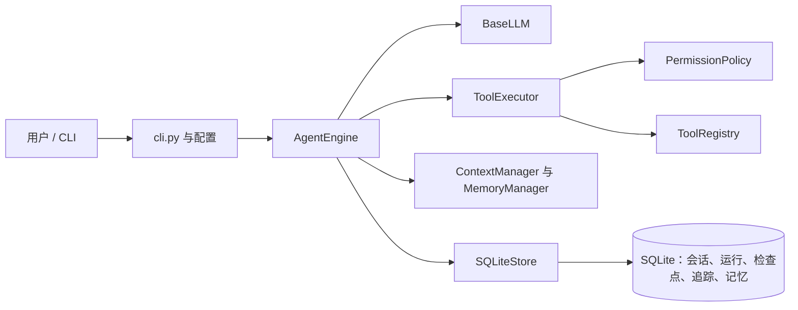
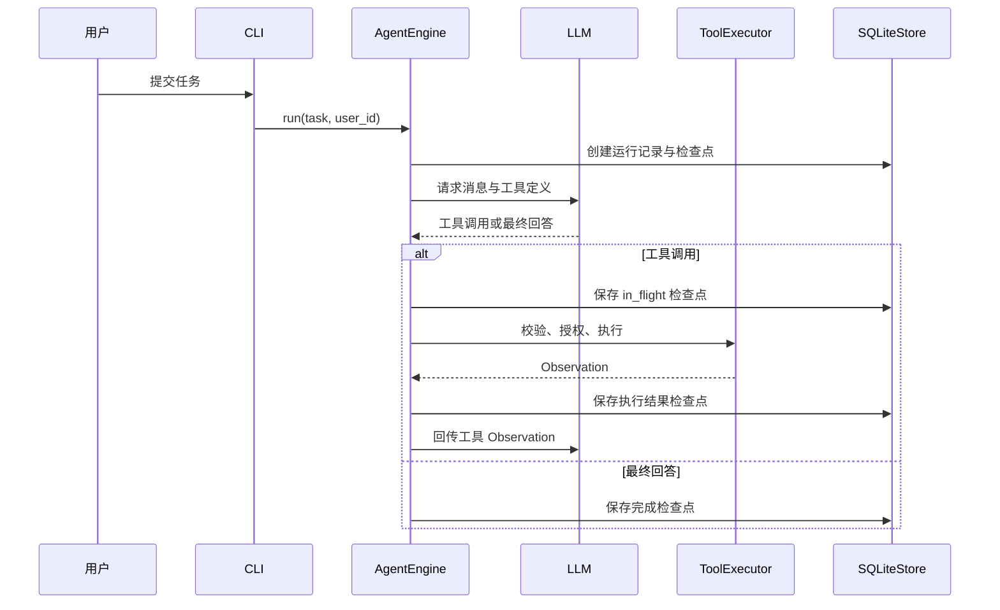

# 架构说明

MiniClaw 只有一个执行核心：`AgentEngine`。同步的 `AgentLoop` 与异步的 `AsyncAgentLoop` 都委托给它，因此两种 API 使用完全一致的权限、预算、上下文、记忆、Trace、Checkpoint 与结果语义。

`portable` 模式将严格 JSON 嵌入文本提示，解析为 `tool_call` 或 `final_answer`；`native` 模式发送 OpenAI-compatible 消息和工具 schema。每一条 assistant `tool_calls` 消息后都必须紧跟带相同 `tool_call_id` 的 `tool` 消息。

`ContextManager` 限制单次工具结果大小，并压缩旧历史，同时保留摘要、明确标记的重要消息和 Native 工具调用关联。`MemoryManager` 管理选择性长期记忆；SQLite Checkpoint 管理短期恢复状态。Trace 只用于诊断，不能被当成重新执行工具的指令。
